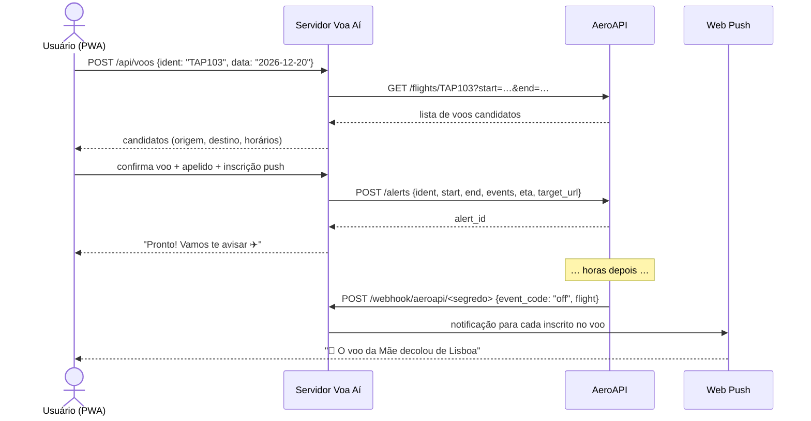

# 02 · v1: Alertas de voo

## Histórias de usuário

| ID | Como… | Quero… | Para… |
|---|---|---|---|
| H1 | quem espera | digitar o número do voo e a data | começar a acompanhar |
| H2 | quem espera | confirmar que é o voo certo (origem, destino, horário) | não acompanhar o voo errado |
| H3 | quem espera | dar um apelido ("Mãe", "Ana") | receber mensagens personalizadas |
| H4 | quem espera | receber push quando decolar, atrasar, estiver chegando e pousar | não precisar ficar conferindo |
| H5 | quem espera | ver uma tela com o status atual do voo | consultar a qualquer momento |
| H6 | quem espera | parar de acompanhar | não receber mais avisos |
| H7 | quem viaja | compartilhar um link do voo | a família acompanhar sem digitar nada |

## Fluxo principal

## Telas

1. **Início:** campo "Número do voo" (ex.: `LA3054`, `TAP103`), seletor de data (padrão: hoje) e botão **Acompanhar**.
2. **Confirmação:** cartões com os voos encontrados (companhia, origem → destino, horário previsto). O usuário escolhe um, preenche o apelido opcional e toca em **Avisar-me**, o que dispara o pedido de permissão de notificação.
3. **Status do voo:** linha do tempo (Previsto → Decolou → Em voo → Pousou → No portão), horários previstos e reais, atraso em destaque e botão **Compartilhar**.
4. **Meus voos:** lista dos voos acompanhados neste aparelho, com opção de remover.

## Notificações

| Evento AeroAPI | Quando | Mensagem (exemplo) |
|---|---|---|
| `out` | Saiu do portão | 🚪 O voo da **Mãe** saiu do portão em Lisboa |
| `off` / `departure` | Decolou | 🛫 O voo da **Mãe** decolou de Lisboa. Chegada prevista às **18:40** |
| `minutes_out` (via `eta`) | X minutos antes da chegada | ⏳ O voo da **Mãe** pousa em cerca de **40 min** em Guarulhos. Hora de sair! |
| `on` / `arrival` | Pousou | 🛬 O voo da **Mãe** pousou em Guarulhos às **18:52** |
| `in` | Chegou ao portão | ✅ A **Mãe** chegou ao portão. Desembarque em breve |
| `cancelled` | Cancelado | ❌ O voo da **Mãe** foi **cancelado** pela companhia |
| `diverted` | Desviado | ⚠️ O voo da **Mãe** foi **desviado** para Campinas |
| *(atraso, ver abaixo)* | Atraso ≥ 15 min | 🕒 O voo da **Mãe** está **atrasado 35 min**. Nova chegada: **19:15** |

Sem apelido, a mensagem usa o número do voo ("O voo TAP103 decolou…").
Os horários são exibidos **no fuso do aeroporto de destino**, que é o que importa para quem espera.

### Detecção de atraso

A AeroAPI não tem um evento de alerta específico para atraso. Existe o código `change` no payload do webhook, mas a documentação não diz quando ele dispara. A estratégia da v1:

1. Toda entrega de webhook traz o objeto `flight` com `estimated_*` e `scheduled_*`. O servidor compara os dois e, se a diferença na chegada passar de 15 min **e mudou desde o último aviso**, envia uma notificação de atraso.
2. **Antes da decolagem**, quando ainda não chegou nenhum webhook, o servidor consulta `GET /flights/{fa_flight_id}` em momentos fixos: 3 h, 1 h e 15 min antes da partida prevista. São 3 consultas × US$ 0,005 por voo.
3. Validar com voos reais se o `change` chega sozinho. Se chegar, ele substitui o passo 2.

## Regras de negócio

- **R1.** Um alerta na AeroAPI **por voo**, não por usuário. Várias pessoas acompanhando o mesmo voo compartilham o alerta (economia de custo).
- **R2.** O alerta é criado com `start`/`end` = data do voo e é **apagado** (`DELETE /alerts/{id}`) após o evento `in`, cancelamento ou 24 h depois da chegada prevista.
- **R3.** Quando o último inscrito remove o voo, o alerta é apagado.
- **R4.** Cadastro aceito somente para voos entre **hoje e +2 dias**, que é o limite de `/flights/{ident}` para voos futuros.
- **R5.** Limite de **5 voos ativos por aparelho** na v1 (proteção de custo).
- **R6.** Prefira o ident **ICAO** (`TAP103`). Se o usuário digitar IATA (`TP103`), resolva com `GET /flights/{ident}/canonical` (US$ 0,001).
- **R7.** O mesmo evento não gera duas notificações para o mesmo voo (deduplicação por `alert_id` + `event_code` + horário).

## Critérios de aceite da v1

- [ ] Cadastro de um voo real de hoje, com confirmação mostrando origem, destino e horários corretos
- [ ] Push recebido no Android (Chrome) e no iOS 16.4+ com a PWA instalada na tela inicial
- [ ] Decolagem, aproximação e pouso notificados com no máximo 2 min de diferença do FlightAware
- [ ] Atraso ≥ 15 min notificado antes da decolagem
- [ ] Alerta apagado na AeroAPI depois do pouso (conferir em `GET /alerts`)
- [ ] Link compartilhado abre a tela de status e permite se inscrever
- [ ] Custo médio medido ≤ US$ 0,15 por voo acompanhado (`GET /account/usage`)
