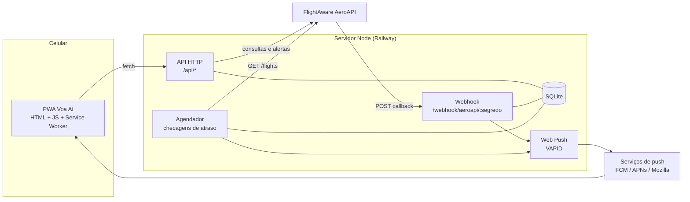
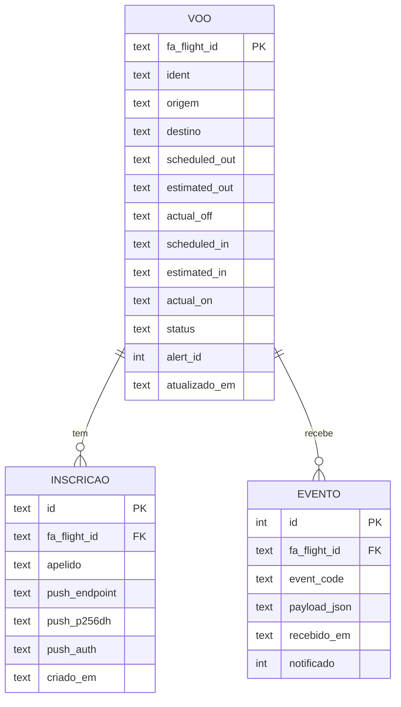

# 03 · Arquitetura

## Visão de componentes



## Stack

| Camada | Escolha | Motivo |
|---|---|---|
| Front | HTML + CSS + **JavaScript puro** (ES modules), sem framework | Leve, e o Three.js entra direto na v2 ([ADR-002](07-decisoes.md)) |
| PWA | `manifest.webmanifest` + Service Worker | Instalável e recebe push com o app fechado |
| Servidor | **Node 20+**, HTTP nativo ou Fastify | Mesma linguagem do front e do escrithorius-3d |
| Banco | **SQLite** (`better-sqlite3`) | Um arquivo só, sem servidor extra. Suficiente para a v1 |
| Push | `web-push` com chaves VAPID | Já usado no escrithorius-3d |
| Deploy | **Railway** com volume persistente para o SQLite | URL pública para o webhook. Já usado no RepoPrint |

## Estrutura de pastas (proposta)

```
voa-ai/
├── docs/                  # esta documentação
├── public/                # PWA (servida estaticamente)
│   ├── index.html
│   ├── app.js
│   ├── sw.js              # service worker: push + cache
│   ├── manifest.webmanifest
│   └── icones/
├── server/
│   ├── index.js           # bootstrap HTTP
│   ├── rotas/             # api.js, webhook.js
│   ├── aeroapi.js         # cliente AeroAPI (fetch + x-apikey)
│   ├── alertas.js         # cria, apaga e deduplica alertas
│   ├── mensagens.js       # event_code → texto em PT-BR
│   ├── push.js            # web-push
│   ├── agendador.js       # checagens de atraso
│   └── db.js              # SQLite + migrações
├── test/
├── .env.example
└── package.json
```

## API interna do Voa Aí

| Método | Rota | Descrição |
|---|---|---|
| `GET` | `/api/voos/buscar?ident=TAP103&data=2026-12-20` | Busca os candidatos na AeroAPI (com cache) |
| `POST` | `/api/inscricoes` | `{fa_flight_id, apelido, push_subscription}`: cria a inscrição e o alerta, se ainda não existir |
| `GET` | `/api/voos/:fa_flight_id` | Status atual (do banco, atualizado pelos webhooks) |
| `DELETE` | `/api/inscricoes/:id` | Para de acompanhar. Apaga o alerta se for o último inscrito |
| `GET` | `/api/push/chave` | Chave pública VAPID para o front |
| `POST` | `/webhook/aeroapi/:segredo` | Recebe os callbacks da AeroAPI |
| `GET` | `/saude` | Health check para o Railway |

## Modelo de dados



## Segurança

| Risco | Mitigação |
|---|---|
| **Vazamento da chave AeroAPI** (gera custo para você) | A chave fica só no servidor (`AEROAPI_KEY` no Railway). Nunca no front nem no git |
| **Webhook falso** (a AeroAPI **não assina** os callbacks) | URL do webhook com um segredo aleatório longo (`/webhook/aeroapi/<32+ chars>`), passado como `target_url` em cada alerta. Opcionalmente, conferir o `alert_id` contra o banco e consultar `/flights/{id}` antes de notificar eventos críticos (cancelado/desviado) |
| **Abuso de cadastro** (alguém cria milhares de alertas) | Limite por aparelho (R5), rate limit por IP e teto global diário de alertas criados |
| **Dados pessoais** | Guardamos só o apelido e a inscrição push. Tudo é apagado 7 dias depois do voo |
| **Push para inscrição morta** | Remover a inscrição quando o serviço de push responder 404/410 |

## Variáveis de ambiente

| Variável | Exemplo | Uso |
|---|---|---|
| `AEROAPI_KEY` | `…` | Chave da AeroAPI |
| `WEBHOOK_SEGREDO` | 48 caracteres aleatórios | Parte secreta da URL do webhook |
| `URL_PUBLICA` | `https://voa-ai.up.railway.app` | Para montar o `target_url` |
| `VAPID_PUBLICA` / `VAPID_PRIVADA` | gerar com `npx web-push generate-vapid-keys` | Web Push |
| `VAPID_CONTATO` | `mailto:…` | Exigido pelo protocolo Web Push |
| `DB_CAMINHO` | `/data/voa-ai.sqlite` | Volume persistente do Railway |

## Observações sobre iOS

Desde o iOS 16.4, o Web Push funciona **somente com a PWA adicionada à tela inicial** (Safari → Compartilhar → Adicionar à Tela de Início). A tela de confirmação precisa detectar o iOS e explicar esse passo antes de pedir permissão.
