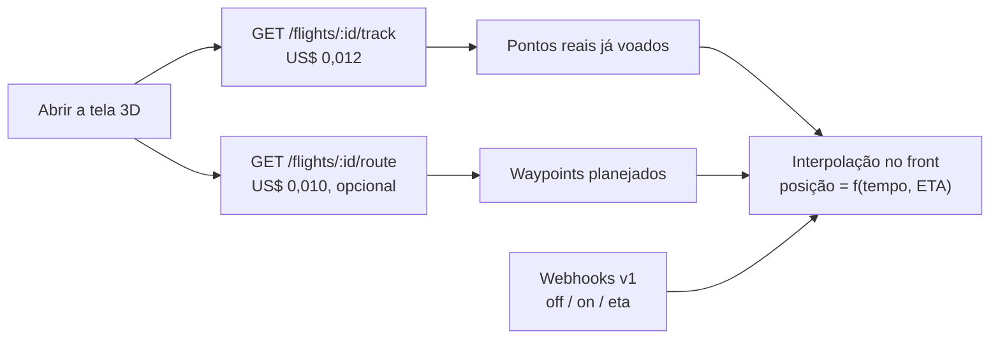

# 06 · v2: Voa Aí em 3D

> Status: **visão**, com protótipo visual em [`prototipo/v2/`](../prototipo/v2/index.html) (ver [11 · Visual da v2](11-v2-visual.md)).

## A ideia

Ao abrir um voo acompanhado, em vez de só uma linha do tempo, você vê o **avião voando num globo 3D**: rota real, trecho já percorrido, posição atual estimada e o aeroporto de destino brilhando à espera. É a mesma pegada do [escrithorius-3d](https://github.com/AndreRuperto/escrithorius-3d), que transforma dados em um mundo 3D explorável.

## Experiência

| Elemento | Descrição |
|---|---|
| **Globo** | Terra low-poly com dia e noite (terminador solar calculado pelo horário UTC) |
| **Rota** | Arco geodésico (grande círculo) entre origem e destino. O trecho voado em cor sólida e o restante tracejado |
| **Avião** | Modelo low-poly orientado pela direção do voo, com rastro |
| **Câmera** | Modos "Acompanhar o avião", "Visão do destino" e "Livre" (orbit) |
| **Aeroportos** | Pinos com código IATA e horário local |
| **HUD** | Altitude, velocidade, tempo restante e ETA no fuso do destino |
| **Momentos** | Animação de decolagem e de pouso quando chegam os eventos `off` e `on` |

### Aproveitar a tela grande

Na v1, as telas de formulário (início, confirmação, meus voos) ficam numa coluna de 440 px no centro. Num monitor de 1800 px, sobram faixas vazias enormes dos dois lados (visto no protótipo em 13/11/2026). A v2 deve usar a largura toda no desktop:

- **Início:** o globo ocupa a tela inteira como fundo vivo, mostrando os voos acompanhados (ou o céu do momento), e o formulário flutua num painel lateral, sem ficar perdido no meio.
- **Status:** o globo é o palco em tela cheia. A placa, a linha do tempo e o HUD viram painéis sobrepostos nas bordas, que dá para recolher.
- **Meus voos:** lista lateral e todos os voos ao mesmo tempo no globo; clicar num card leva a câmera até ele.
- **Regra geral:** a partir de 960 px, nenhuma tela fica numa coluna estreita no centro com o resto vazio. Ou o conteúdo se reorganiza em colunas, ou o globo preenche o espaço. No celular continua a coluna única da v1.

## Dados e estratégia de custo

- **Uma chamada ao abrir** (`/track`) traz o histórico real. O restante do caminho é estimado com a rota planejada (`/route`) ou com o grande círculo até o destino, ajustado pelo `estimated_on`.
- Os webhooks da v1 continuam corrigindo os horários. Nada de polling por minuto (ver [05-custos.md](05-custos.md#v2-3d-atenção-ao-custo)).
- Cache no servidor: várias pessoas abrindo o mesmo voo em até 5 min reutilizam o mesmo `/track`.

## Stack

| Item | Escolha |
|---|---|
| Render | **Three.js** dentro da própria PWA (sem Electron: precisa rodar no celular) |
| Globo | Esfera com textura low-poly ou geometria própria. Coordenadas lat/lon → vetor 3D |
| Arcos | `CatmullRomCurve3` sobre pontos do grande círculo elevados pela altitude |
| Desempenho | Alvo de 60 fps em celular intermediário. Carregar a cena só na tela do voo (import dinâmico) |
| Reaproveitamento | Padrões de câmera, iluminação low-poly e organização de cena do escrithorius-3d |

## Perguntas em aberto

- Mostrar **outros voos** ao redor (tráfego aéreo)? Isso exigiria `/flights/search`, a US$ 0,050 cada, e é caro.
- Modo **"janela do avião"** (visão em primeira pessoa)?
- Modelos de avião por tipo (`aircraft_type`: A320, B738, A339…) ou um modelo genérico?
- Compartilhar um **vídeo/GIF** da rota depois do pouso?
