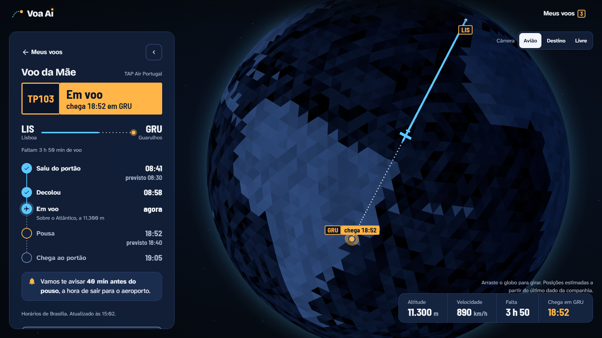

# 11 · Visual da v2: globo e tela larga

> Status: **protótipo navegável**, com dados simulados. Arquivo: [`prototipo/v2/index.html`](../prototipo/v2/index.html).
> Feito em 14/11/2026. Junta a [09 · Direção visual](09-direcao-visual.md) (`/visual-frontend`) com a [10 · Design](10-design.md) (`/design`) e aplica a regra de [06 · Aproveitar a tela grande](06-v2-3d.md#aproveitar-a-tela-grande).



## O que veio de cada direção

| Tema | Fica da 09 (`/visual-frontend`) | Fica da 10 (`/design`) |
|---|---|---|
| Identidade | — | Marca "Voa Aí" em Bricolage Grotesque 800, com o acento do "í" como ponto âmbar aceso e o arco tracejado em céu |
| Cor | — | Paleta "céu noturno, luz de pista": `noite-950/900/800`, âmbar `#FFB547`, céu `#5CC8FF`, estados `pousou`, `atraso` e `cancelado` |
| Tema | — | Escuro como padrão. Na v2 é o único: o globo é a noite |
| Estado do voo | **Placa de pista**, com painéis de posição, direção, atraso e cancelado | As cores da placa passam a ser as da paleta 10 |
| Tipografia | **Atkinson Hyperlegible Next** no texto e no campo (distingue `O`/`0`) e **Barlow Semi Condensed** na placa, nos códigos e nos horários | Bricolage só na marca e nos títulos. Saem a Inter e a JetBrains Mono |
| Textos | Todos os textos da v1 (pergunta inicial, erros, "E agora?", "Me avisar") | Rodapé de privacidade no início |
| Linguagem da rota | Linha do tempo com passado, agora e futuro | Voado sólido em céu, restante tracejado, destino aceso em âmbar. Vale igual no trajeto do painel, na linha do tempo e no globo |

O princípio continua o da 09: **o único elemento ousado do painel é a placa**. No desktop, o segundo protagonista é o globo, e ele fica fora do painel.

## Tokens da v2

| Token | Valor | Uso |
|---|---|---|
| `--c-espaco` | `#05090F` | Fundo da cena 3D |
| `--c-fundo` | `#0B1426` | Página, placa de posição, celular |
| `--c-superficie` | `#12203A` | Painel, cartões |
| `--c-campo` | `#1B2D4F` | Campos, notas |
| `--c-linha` | `#2A3F66` | Divisórias decorativas |
| `--c-linha-forte` | `#6E83A8` | Borda de controle (4,23:1 sobre a superfície) |
| `--c-tinta` / `--c-tinta-suave` | `#F2F5FA` / `#A9B6CC` | Texto (7,92:1 o suave) |
| `--c-pista` | `#FFB547` | Placa de direção, botão principal, destino, foco |
| `--c-ceu` | `#5CC8FF` | Em voo, trecho voado, avião, etapas feitas |
| `--c-atraso` | `#FF8A65` | Painel de atraso |
| `--c-cancelado` | `#FF6B7A` | Painel de cancelado, erros |
| `--c-placa-tinta` | `#0B1426` | Texto sobre qualquer placa colorida |

Contraste medido do texto escuro sobre as placas: âmbar 10,46:1, atraso 7,94:1, cancelado 6,68:1. A 09 usava branco sobre o vermelho; com o `#FF6B7A` da 10 o branco não passa, então todas as placas usam tinta escura.

## Layout

```
DESKTOP (≥ 960 px)                                         CELULAR (< 960 px)
┌──────────────────────────────────────────────────────┐   ┌──────────────────┐
│ ⋰• Voa Aí                                Meus voos 3 │   │ ⋰• Voa Aí   Meus │
│ ┌──────────────┐                  Câmera [Avião|...] │   │   ╭──globo──╮    │  ← só nas telas
│ │ ← Meus voos ‹│            ╭─────────╮              │   │  ✈┈┈┈┈┈◎ GRU     │    de voo
│ │ Voo da Mãe   │          ╱  ✈┈┈┈┈┈┈◎ ╲             │   ├──────────────────┤
│ │ [TP103|Em voo]│         │  globo 3D  │             │   │ Voo da Mãe       │
│ │ LIS ━━━┈┈┈◎ GRU│        ╲            ╱             │   │ [TP103|Em voo]   │
│ │ ● Decolou    │            ╰─────────╯              │   │ LIS ━━┈┈◎ GRU    │
│ │ ◉ Em voo     │                                      │   │ [HUD em grade]   │
│ │ ○ Pousa      │              [Alt|Vel|Falta|Chega]   │   │ ● ◉ ○ etapas     │
│ └──────────────┘                                      │   └──────────────────┘
└──────────────────────────────────────────────────────┘
```

- **Desktop:** o globo ocupa a janela inteira. O painel de 440 px flutua à esquerda, translúcido. A câmera usa `setViewOffset` para centralizar o globo na área livre à direita, e não no meio da janela.
- **Painel recolhível** nas telas de voo: o botão `‹` esconde o painel e o globo volta para o centro. "Mostrar detalhes do voo" traz o painel de volta, e o foco do teclado acompanha.
- **Celular:** coluna única, como na v1. O globo só aparece no status (em voo e atrasado), como uma faixa de 44% da altura no topo, e o painel sobe por cima dele ao rolar. O HUD entra no painel, em grade.

## O globo

| Elemento | Como foi feito |
|---|---|
| Terra | Icosaedro com uma cor por face e sombreamento plano (visual low-poly). Os continentes vêm do Natural Earth 110m (`world-atlas`), desenhados num mapa de bits e amostrados no centro de cada face. Sem rede, o globo fica só com o oceano e o resto funciona |
| Dia e noite | Luz direcional na posição do ponto subsolar para a hora da tela (15:02 de Brasília). O lado da noite fica escuro, mas visível |
| Rota | Arco do grande círculo, elevado conforme a distância. Trecho voado como tubo em céu e o restante em pontinhos brancos a 70% |
| Avião | Modelo low-poly em céu, orientado pela tangente da rota. No solo, fica na origem, apontado para o destino |
| Destino | Ponto âmbar com halo pulsando ("o aeroporto brilhando à espera"). Em voo cancelado, ponto vermelho e sem halo |
| Rótulos | HTML sobre o 3D, no formato da placa mini. Somem quando o ponto vai para o lado de trás do globo |
| Câmera | Modos **Avião**, **Destino** e **Livre**. Arrastar o globo muda para Livre. As transições levam 1,3 s, com curva suave |
| HUD | Altitude, velocidade, quanto falta e a chegada (em âmbar), sempre com o aviso de que a posição é estimada |

O que cada tela mostra no globo:

| Tela | Globo |
|---|---|
| Início | Todos os voos acompanhados, com rotação lenta |
| Confirmação | Os dois voos encontrados. O escolhido fica aceso e o outro esmaecido, e a câmera vai até ele |
| Status | Só o voo, com a câmera no modo Avião, o HUD e os controles de câmera |
| Meus voos | Todos os voos. Passar o mouse num item (ou chegar nele pelo Tab) leva a câmera até ele e esmaece os outros |

## Telas

| Tela | Desktop | Celular |
|---|---|---|
| Início | [captura](visual/v2-inicio-d.png) | [captura](visual/v2-inicio-m.png) |
| Confirmação | [captura](visual/v2-confirmacao-d.png) | — |
| Status em voo | [captura](visual/v2-status-d.png) | [captura](visual/v2-status-m.png) |
| Status atrasado | [captura](visual/v2-status-atraso-d.png) | — |
| Status cancelado | [captura](visual/v2-status-cancelado-d.png) | — |
| Meus voos | [captura](visual/v2-meus-voos-d.png) | — |

Mudanças de conteúdo em relação à v1:

- O status atrasado agora é de outro voo (Vô Zé, G31450, Recife a Congonhas, +50 min). Na v1, a lista mostrava o Vô Zé mas abria um atraso do voo da Mãe.
- A tela de erro separada virou erro no próprio campo do início.
- A faixa 2D da rota virou o **trajeto** em uma linha no painel. O desenho fica com o globo.

## Acessibilidade

- O canvas é `aria-hidden`. Tudo o que ele mostra também está em texto no painel: trajeto com `role="img"` e descrição, placa com `aria-label` e HUD como lista de definições (`<dl>`).
- Botões de câmera com `aria-pressed`. O botão de esconder o painel tem nome ("Esconder detalhes e ver só o globo").
- Foco em anel âmbar de 3 px, com 9:1 sobre o painel.
- Sem rolagem lateral em 375 px.
- `prefers-reduced-motion`: sem rotação automática, sem pulso do halo, e a câmera e o painel mudam sem animação.

## Ainda não verificado

- Desempenho em celular intermediário (a meta da [06](06-v2-3d.md#stack) é 60 fps). O render pausa com a aba escondida e quando o globo não aparece.
- Leitor de tela de verdade (VoiceOver e TalkBack). Só a árvore de acessibilidade foi conferida.
- O protótipo carrega o three.js, o `world-atlas` e as fontes de CDN. No app, tudo isso precisa ir para o `public/`, e a cena precisa ser carregada só na tela do voo (import dinâmico).
- A prancha [Voa Aí · Design](https://claude.ai/artifact/6LYsBMUph2SRaWdULXAn14) ainda mostra as fontes Inter e JetBrains Mono e não tem a placa. Precisa ser atualizada com esta junção.
