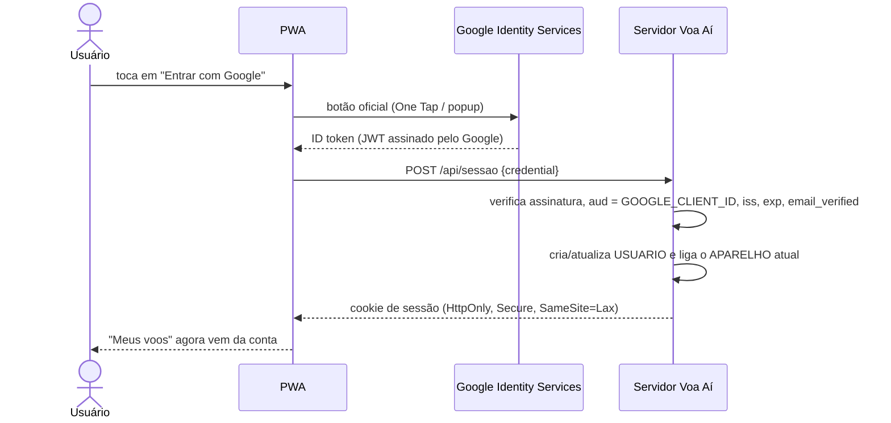
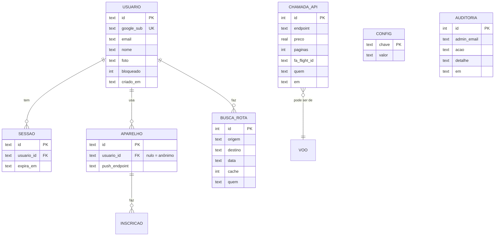

# 12 · Contas Google, busca por rota e painel de admin

> Status: **especificação + protótipo**. Design na prancha [Voa Aí · Design](https://claude.ai/artifact/6LYsBMUph2SRaWdULXAn14) (seção "Contas, rotas e admin") e protótipo navegável em [`prototipo/v2/`](../prototipo/v2/index.html) e [`prototipo/admin/`](../prototipo/admin/index.html), com dados simulados.
> Decisões em [ADR-006](07-decisoes.md#adr-006--conta-google-opcional) e [ADR-007](07-decisoes.md#adr-007--busca-por-rota-de-aeroporto-a-aeroporto).

## Resumo

| Recurso | O que é | O que **não** é |
|---|---|---|
| **Conta Google** | Opcional. Quem entra sincroniza "Meus voos" entre aparelhos e pode acompanhar mais voos | Não é exigida para acompanhar um voo nem para abrir um link compartilhado. O princípio "zero atrito" ([01](01-visao-geral.md)) continua valendo |
| **Busca por rota** | Escolher origem e destino (país → aeroporto) e uma data, ver os voos sem escala desse dia e escolher um para acompanhar | Não é assinar a rota inteira. Cada voo acompanhado continua sendo uma inscrição normal da v1 |
| **Painel de admin** | Uma página para você ver custo da AeroAPI, uso, voos ativos e contas, e ajustar limites | Não é para usuários. Só entra quem estiver na lista `ADMIN_EMAILS` |

## Histórias novas

| ID | Como… | Quero… | Para… |
|---|---|---|---|
| H8 | quem espera | entrar com Google (se eu quiser) | ver meus voos no celular e no computador |
| H9 | quem espera | buscar os voos de uma rota (ex.: Portugal → Brasil) num dia | achar o voo sem saber o número |
| H10 | dono do Voa Aí | ver quanto a AeroAPI custou no mês e por quê | não estourar o crédito |
| H11 | dono do Voa Aí | ajustar limites e pausar buscas caras | controlar o custo sem fazer deploy |
| H12 | dono do Voa Aí | ver contas e voos ativos e remover abuso | proteger o serviço |

## Contas Google (opcional)

### Fluxo

- **Biblioteca:** Google Identity Services no front (botão oficial, sem desenhar um botão falso) e `google-auth-library` no servidor para validar o ID token. Não precisamos de acesso à API do Google, só da identidade, então os escopos são `openid email profile`.
- **Sessão:** cookie `HttpOnly`, `Secure`, `SameSite=Lax`, 30 dias, com ID aleatório guardado na tabela `SESSAO`. Nada de JWT próprio no `localStorage`.
- **Ao entrar:** os voos que já estavam no aparelho passam para a conta (sem duplicar inscrições no mesmo `fa_flight_id`).
- **Ao sair:** o aparelho volta a ser anônimo e continua com os voos que já tinha. Os outros aparelhos da conta não mudam.
- **Apagar conta:** em "Minha conta". Apaga `USUARIO`, sessões e o vínculo dos aparelhos; as inscrições anônimas do aparelho atual continuam.

### Limites (substituem a R5)

| Quem | Voos ativos ao mesmo tempo | Buscas por rota por dia |
|---|---|---|
| Sem conta | 5 por aparelho | 3 por aparelho |
| Com conta Google | 15 por conta (somando os aparelhos) | 10 por conta |

Os números ficam na tabela `CONFIG` e o admin muda sem deploy.

### Dados guardados

Só o necessário: `google_sub` (identificador estável), e-mail, nome e foto que o Google devolve. Não guardamos o ID token. A política "apagamos 7 dias depois do pouso" continua valendo para voos e inscrições; a conta fica até ser apagada.

## Busca por rota

A AeroAPI busca voos entre **dois aeroportos** (`GET /airports/{id}/flights/to/{dest_id}`), não entre países. Então o país é um filtro de interface, e quem paga é cada par de aeroportos.

### Fluxo na tela

1. **De:** escolher país (ex.: Portugal) → aparecem os aeroportos principais (LIS, OPO, FAO). Já vem marcado o maior.
2. **Para:** país (ex.: Brasil) → aeroportos principais (GRU, GIG, BSB, REC, FOR…), sem nenhum marcado.
3. **Data:** os mesmos 3 botões da v1 (hoje, amanhã, +2), por causa do limite de 2 dias no futuro.
4. **Buscar voos** → lista de voos sem escala, com companhia, número, horários e duração.
5. Tocar num voo → a mesma tela de confirmação da v1 (apelido e "Me avisar").

A lista de países e aeroportos é estática, no nosso banco (carga inicial a partir de uma base pública de aeroportos), então montar a tela não custa nada na AeroAPI.

### Custo

| Item | Preço | Observação |
|---|---|---|
| `/airports/{origem}/flights/to/{destino}` | US$ 0,050 por conjunto de resultados | Sempre com `start`/`end` no dia escolhido e `connection=nonstop` |
| Cache por par + dia | — | 30 min, compartilhado entre todo mundo |
| Teto por busca | — | No máximo **3 pares** de aeroportos por busca (ex.: LIS→GRU, LIS→GIG, OPO→GRU) |

Uma busca típica (1 par, 1 página) custa **US$ 0,05**, metade de um voo inteiro acompanhado. Por isso o limite diário por pessoa e o interruptor no admin para desligar a busca por rota se o custo disparar.

## Painel de admin

### Acesso

- Rota `/admin`, fora do PWA público.
- Exige sessão Google e e-mail na variável `ADMIN_EMAILS`. Quem não estiver na lista recebe 404, não 403.
- Toda ação do admin (mudar limite, remover conta, pausar busca) vai para a tabela `AUDITORIA`.

### Seções

| Seção | Mostra | Ações |
|---|---|---|
| **Visão geral** | Gasto do mês na AeroAPI contra o crédito (US$ 5 no Personal, US$ 100 no Standard), projeção para o fim do mês, gasto por dia, gasto por tipo de chamada, voos ativos, alertas entregues, contas e buscas por rota | — |
| **Voos** | Voos ativos e recentes: número, rota, estado, inscritos, alertas entregues, custo acumulado | Apagar o alerta de um voo (para os avisos de todos os inscritos) |
| **Contas** | Contas Google: e-mail, voos ativos, buscas no mês, último acesso | Bloquear, apagar |
| **Rotas** | Pares de aeroportos mais buscados, acertos de cache, custo | — |
| **Limites** | Os números da tabela de limites, teto diário de alertas criados, teto mensal de gasto | Editar; **pausar buscas por rota**; **modo econômico** (desliga o evento `in`) |

### De onde vem o custo

A AeroAPI não tem um endpoint de uso da conta. O servidor registra **cada chamada** na tabela `CHAMADA_API` (endpoint, preço unitário da tabela, páginas, voo, quem disparou) e **cada alerta entregue** (US$ 0,020) ao receber o webhook. O painel soma isso. O valor é uma estimativa; a fatura da FlightAware é a fonte oficial, e o painel diz isso.

### Alertas automáticos para o admin

- Gasto do mês passou de 50% e de 80% do crédito → push e e-mail para os admins.
- Teto mensal atingido → as buscas por rota pausam sozinhas; acompanhar por número continua.

## Mudanças na arquitetura ([03](03-arquitetura.md))

### Rotas novas

| Método | Rota | Descrição |
|---|---|---|
| `POST` | `/api/sessao` | `{credential}` do Google → cria sessão |
| `DELETE` | `/api/sessao` | Sai |
| `GET` | `/api/eu` | Conta atual (ou `null`) e limites |
| `DELETE` | `/api/eu` | Apaga a conta |
| `GET` | `/api/lugares/paises` · `/api/lugares/aeroportos?pais=PT` | Lista estática |
| `GET` | `/api/rotas/buscar?de=LPPT&para=SBGR&data=2026-12-20` | Busca por rota (com cache e limites) |
| `GET` | `/api/admin/resumo?mes=2026-11` | Números da visão geral |
| `GET` | `/api/admin/voos` · `/api/admin/contas` · `/api/admin/rotas` | Tabelas |
| `PUT` | `/api/admin/config` | Altera limites e interruptores |

### Tabelas novas

### Variáveis de ambiente novas

| Variável | Exemplo | Uso |
|---|---|---|
| `GOOGLE_CLIENT_ID` | `…apps.googleusercontent.com` | Validar o ID token |
| `ADMIN_EMAILS` | `voce@exemplo.com` | Quem entra no `/admin` (separados por vírgula) |
| `SESSAO_SEGREDO` | 32 bytes aleatórios | Assinar o cookie |
| `CREDITO_MENSAL_USD` | `5` | Base das barras e alertas de gasto |

## Segurança

| Risco | Medida |
|---|---|
| Token falso ou de outro app | Validar assinatura, `aud`, `iss` e `exp` no servidor; nunca confiar no e-mail vindo do front |
| Roubo de sessão | Cookie `HttpOnly`/`Secure`/`SameSite=Lax`; sessão revogável no banco |
| CSRF nas rotas que mudam algo | `SameSite=Lax` + cabeçalho `X-Requested-With` exigido em `POST/PUT/DELETE` |
| Descobrir o admin | `/admin` e `/api/admin/*` devolvem 404 para quem não é admin |
| Busca por rota usada para gastar crédito | Limite por aparelho/conta, cache compartilhado, teto mensal que pausa sozinho |

## Critérios de aceite

- [ ] Acompanhar um voo e abrir um link compartilhado continuam funcionando sem login
- [ ] Entrar com Google num aparelho com 2 voos anônimos leva os 2 para a conta, sem duplicar
- [ ] Os voos da conta aparecem num segundo aparelho depois de entrar
- [ ] Busca LIS → GRU para hoje lista os voos sem escala e a mesma busca em seguida vem do cache (sem chamada nova)
- [ ] Ao passar do limite de buscas, a tela explica o limite e oferece buscar pelo número do voo
- [ ] `/admin` dá 404 sem login e para um e-mail fora de `ADMIN_EMAILS`
- [ ] O gasto do painel bate com a soma de `CHAMADA_API` + alertas entregues
- [ ] Pausar as buscas por rota no admin desliga a busca na hora, sem deploy
